# 💻 Handsome the Police Dog

In this coding exercise, you will start with plain text about **Handsome** and turn that
text into a working HTML web page. Along the way, you will learn some of the most important
beginner concepts in web design: file organization, file extensions, Visual Studio Code,
HTML page structure, semantic HTML elements, image elements, and attributes.

Don't worry about making the page look interesting yet. There is no CSS in this exercise.
The goal right now is to learn how to build the **structure** of a web page. Later, CSS
will let you control colors, fonts, layout, spacing, and visual design.

The page will look plain when you are finished. **That is expected.** Plain HTML is
supposed to look simple before CSS is added.

> [!IMPORTANT]
> **The companion videos for this exercise are in Canvas**, on the assignment page. They
> walk you through every step, so watch them there instead of working from this README
> alone.

## 🧠 What You Will Learn

By completing this exercise, you will practice how to:

- Open a full project folder in Visual Studio Code
- Explain why file extensions such as `.txt`, `.html`, `.jpg`, and `.png` matter
- Rename a plain text file so it becomes an HTML file
- Create the basic structure of an HTML document
- Use semantic HTML elements such as headings and paragraphs
- Add images to a web page using the `img` element
- Use attributes such as `src` and `alt`
- Preview your HTML page in a browser

## 🪟 Windows Users: Turn On File Extensions First

Windows hides file extensions by default, which makes it hard to tell whether a file is
really an HTML file, a text file, or an image. You are going to rename a `.txt` file to an
`.html` file, so you need to see the full file name. Otherwise you can end up with
`index.html.txt` and not know it.

Canvas has a support page showing how to turn file extensions on. Mac users can skip this
step.

## 🎬 Watch the Videos in Canvas and Follow Along

The screencast videos are on this assignment's page in **Canvas**, not in this repo. They
walk you through the entire exercise. Watch them **in order** and follow along in Visual
Studio Code. Pause whenever you need time to finish a step — it is normal to pause,
rewind, and rewatch parts of a coding demonstration.

You are not expected to memorize everything right away. This first exercise is about
getting comfortable opening project files, using VS Code, typing HTML, saving your work,
and checking your page in a browser.

Each video builds on the previous one, so please don't skip ahead.

| Video | What you will do |
| --- | --- |
| **Part 1 — Setting Up** | Get the project folder ready, open it in VS Code, and prepare the starter file for coding. |
| **Part 2 — Basic HTML Structure** | Create the basic structure of an HTML document: the document type, `html`, `head`, `title`, and `body` elements. |
| **Part 3 — Marking Up the Content** | Identify the purpose of each piece of content and mark it up with semantic HTML elements, including headings and paragraphs. |
| **Part 4 — Adding Images** | Replace the image placeholders with `img` elements and learn how the `src` and `alt` attributes work. |
| **Part 5 — Submitting the Files** | Review the finished project folder before you submit. |

> [!IMPORTANT]
> **A few steps in this repo are different from the videos.** Follow the videos for the
> HTML, and follow this repo for getting your files and submitting:
>
> - **Getting the starter files (Part 1):** don't download a ZIP. Create your own repo
>   from this template and open it with GitHub Desktop, as described in
>   **🏁 Getting Started** below.
> - **Naming your file:** rename `handsome.txt` to **`index.html`**, whatever name the
>   video uses. GitHub Pages only serves `index.html` at your site's root URL; any other
>   name gives you a 404. Rename the file — don't create a second one.
> - **Submitting (Part 5):** don't zip your folder or upload a file. Publish your page to
>   GitHub Pages and submit a pull request URL in Canvas, as described in
>   **📬 Submitting the Assignment** below.

> [!IMPORTANT]
> Open the entire project **folder** in VS Code, not a single HTML file. VS Code needs to
> see every file in the project for your images to work. Keep `index.html`,
> `handsome.jpg`, and `handsome-today.jpg` together in the root folder.

## 📂 Starter Files

| File | Purpose |
| --- | --- |
| `handsome.txt` | The plain text for the article. **Rename this to `index.html`** and add your markup to it. |
| `handsome.jpg` | Historical photo of Handsome. Goes in the first section. |
| `handsome-today.jpg` | Handsome on display today. Goes in the "Handsome Today" section. |

Inside `handsome.txt`, two lines mark where the images belong:

```
[replace this with the image handsome.jpg]
[replace this with the image handsome-today.jpg]
```

Delete each placeholder line and put an `` element in its place.

> [!NOTE]
> `.editorconfig`, `.gitattributes`, `.gitignore`, `.noai`, and the `.github` folder are
> setup files that keep assignments consistent. Leave them alone. `handsome.txt`,
> `handsome.jpg`, and `handsome-today.jpg` are your starter content — keep them in the repo.

## 📂 Where Your Files Go

Create your files in the **root folder** of this repo — the same folder as this README.
GitHub Pages publishes from the root, so `index.html` has to live there or your site will 404. Your files should look like this:

```
index.html
handsome.jpg
handsome-today.jpg
```

For this first exercise, keep everything in the root folder — the images are already there, so
`` just works. In later assignments you will group assets into subfolders
like `css/`, `js/`, and `images/`.

## ✅ Before You Submit

Check the following:

- [ ] `handsome.txt` has been renamed to `index.html` — and is not accidentally named `index.html.txt`
- [ ] `index.html`, `handsome.jpg`, and `handsome-today.jpg` are all in the root folder of the repo
- [ ] The page has the basic HTML structure: `DOCTYPE`, `html`, `head`, `title`, and `body`
- [ ] The main page title is marked up as an `h1`
- [ ] The section headings — *The Policeman's Pal* and *Handsome Today* — are marked up as `h2` elements
- [ ] Each paragraph of article text is inside its own `p` element
- [ ] The copyright line at the end of the text is included on the page
- [ ] Both images appear when you preview the page in a browser
- [ ] Both images include useful `alt` text
- [ ] You saved your file
- [ ] The page is live on GitHub Pages and the URL is in your pull request

## 🛠️ Troubleshooting

If something is not working, check these common issues first:

- Did you save the file?
- Is the file named exactly `index.html`, with no hidden `.txt` on the end?
- Are the image file names in your `src` spelled exactly right, including `.jpg`?
- Are the images in the same folder as `index.html`?
- Did you accidentally move or delete a starter file?
- Is your visible page content inside the `body` element?
- Are your opening and closing tags in the correct places?
- Are there quotation marks around your attribute values?

**Having problems with the videos?**

- **Getting a warning about third-party cookies?** Try using Chrome. Safari's default
  security settings may prevent embedded Canvas videos from playing unless those settings
  are changed.
- **Getting an "Access Denied" error?** Refresh your browser. In many cases, the videos
  will load correctly after the page reloads.

## 📚 Resources

- [MDN — HTML basics](https://developer.mozilla.org/en-US/docs/Learn_web_development/Getting_started/Your_first_website/Creating_the_content)
- [MDN — Headings and paragraphs](https://developer.mozilla.org/en-US/docs/Learn_web_development/Core/Structuring_content/Headings_and_paragraphs)
- [MDN — ``: The Image Embed element](https://developer.mozilla.org/en-US/docs/Web/HTML/Reference/Elements/img)
- [W3C Markup Validation Service](https://validator.w3.org/#validate_by_input) — paste your
  HTML in to catch unclosed tags
- [Cincinnati Police Historical Society](https://www.police-museum.org/)

<details>
<summary><strong>🏁 Getting Started</strong></summary>

1. **Create your own repo from this template.**
   - At the top of this repo on GitHub, click the green **Use this template** button. (If a
     menu opens, choose **Create a new repository**.)

     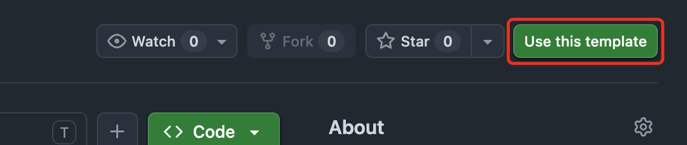
   - Set **Owner** to your GitHub account.
   - Give it a **Repository name** — use the assignment name, like `handsome-the-police-dog`.

     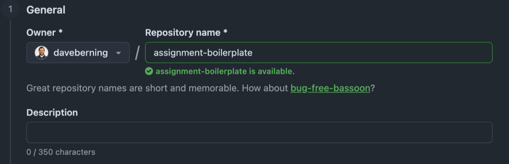
   - Set visibility to **Public** (GitHub Pages needs a public repo on a free account).

     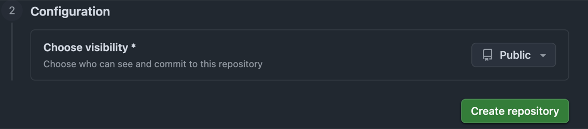
   - Click **Create repository**. GitHub takes you to your new repo.
2. **Open your new repo in GitHub Desktop.**
   - Check that the repo name at the top of the page is `<your-username>/<repo-name>`, not
     this template.
   - Click the green **Code** button → **Open with GitHub Desktop**.
   - GitHub Desktop opens and asks where to save the repo. Pick a folder on your computer
     and click **Clone**.

   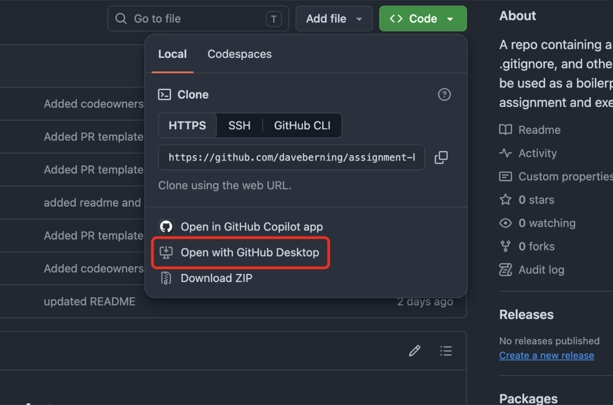

   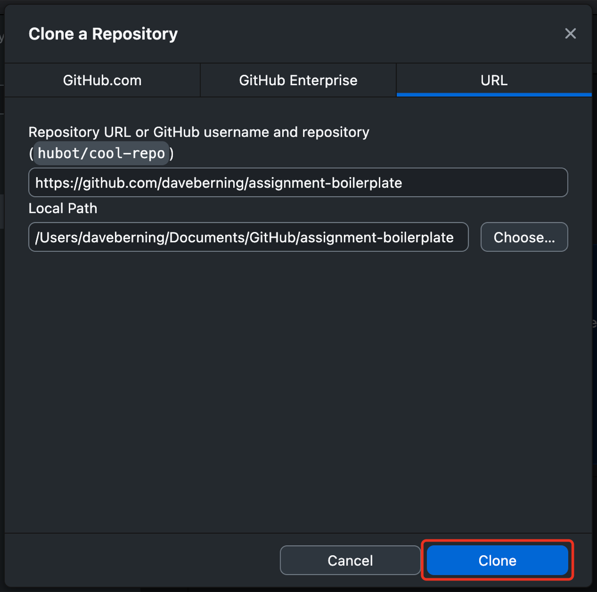
3. In GitHub Desktop, create your assignment branch: **Current Branch** → **New Branch** and name it `develop`.
4. Click **Open in \<editor\>** to open the folder in your code editor and start working.

</details>

<details>
<summary><strong>🤖 AI Policy</strong></summary>

Work on this assignment must be your own. Do not use AI coding assistants — including
GitHub Copilot, Cursor, ChatGPT, Claude, or JetBrains AI Assistant — to generate,
complete, or rewrite your code.

You should be able to explain any line of your submission. You may be asked to do so.

This repo includes a `.noai` file, which disables JetBrains AI Assistant for the project
in IDEs like WebStorm. Leave it in place. It is a reminder of the policy above, not a
substitute for it — following the policy is still your responsibility.

</details>

<details>
<summary><strong>🚀 Publishing to GitHub Pages</strong></summary>

Your work has to be live on the web before you can submit it.

1. **Commit your work in GitHub Desktop.**
   - Make sure **Current Branch** says `develop`.
   - Enter a summary in the bottom-left box, like `Create index.html`, and click
     **Commit to develop**.

   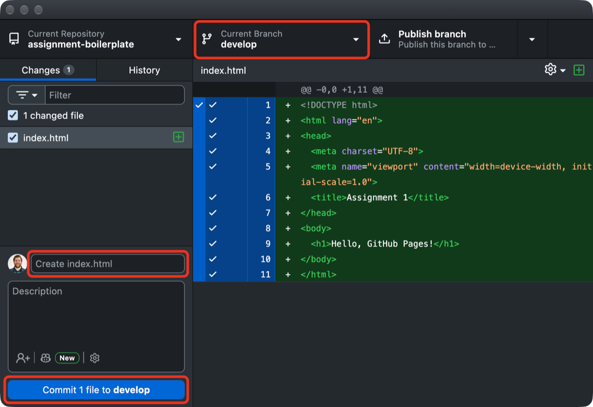
2. **Push your work to GitHub.**
   - The first time, click **Publish branch** at the top. This creates your `develop`
     branch on GitHub.
   - After that, the same button says **Push origin**. Click it after every commit.

   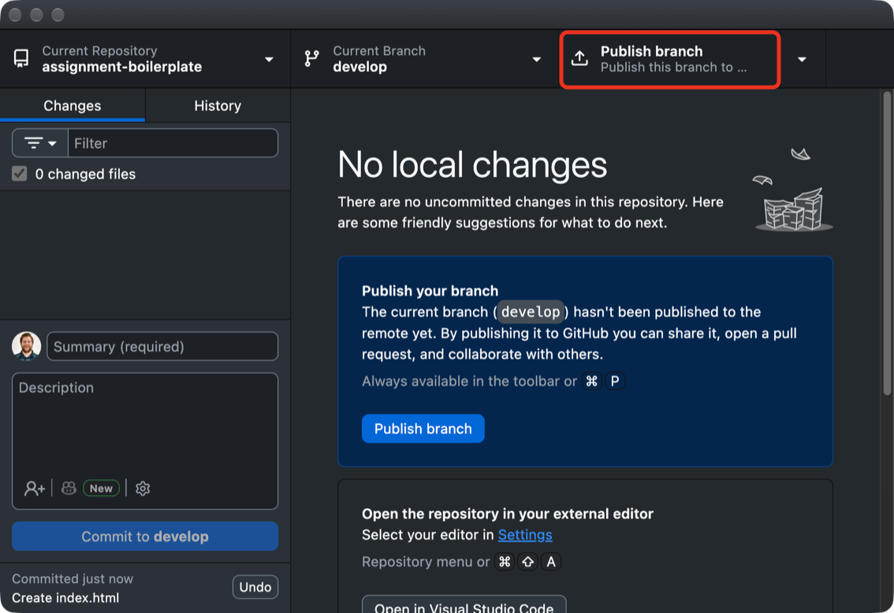
3. **Turn on GitHub Pages.**
   - On GitHub, open **your** repo (the one you created from the template) and go to
     **Settings** → **Pages**.
   - Under **Branch**, click the **None** dropdown and pick `develop`.

     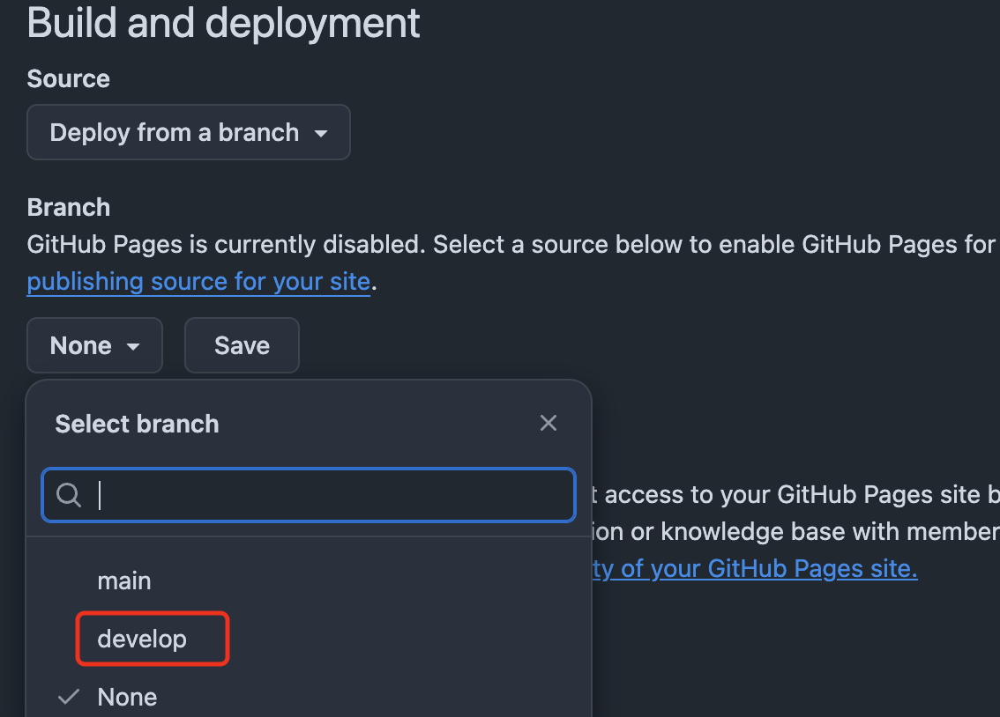
   - Make sure **Source** is *Deploy from a branch* and the folder is `/ (root)`, then click
     **Save**.

     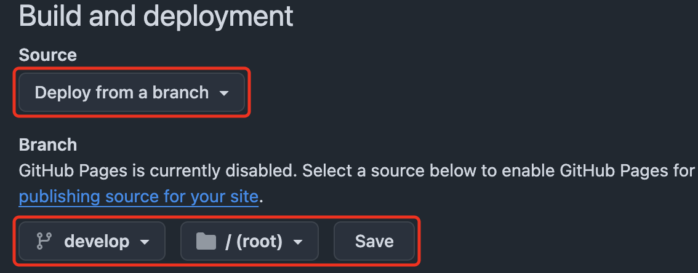
4. **Open your live site.** The first deploy takes a minute or two. Reload the Pages
   settings screen until it says **Your site is live at**, then click the URL:
   ```
   https://<your-username>.github.io/<repo-name>/
   ```

   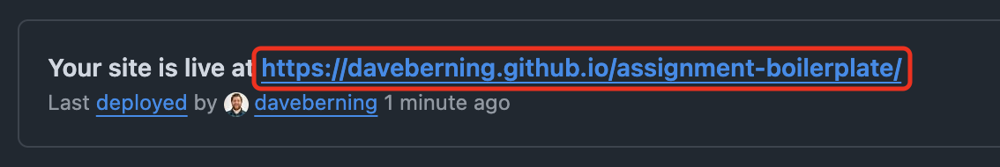

   Confirm the page loads correctly — the right content, no missing images, no broken styles.

**🛠️ Troubleshooting**

- **404 page:** make sure an `index.html` exists in the root of the branch you selected, and that the filename is lowercase.
- **Old version showing:** Pages caches aggressively. Wait a minute, then hard refresh (<kbd>Cmd</kbd>/<kbd>Ctrl</kbd> + <kbd>Shift</kbd> + <kbd>R</kbd>).
- **Nothing deployed:** check the **Actions** tab for a failed `pages build and deployment` run.

</details>

<details>
<summary><strong>📬 Submitting the Assignment</strong></summary>

Submission has two parts: publish the site, then submit a pull request URL in Canvas.

1. **Publish to GitHub Pages** using the steps in **🚀 Publishing to GitHub Pages** above. Do this first.
2. **Open a pull request into `main`.**
   - In **GitHub Desktop**, with `develop` selected, click **Preview Pull Request**, then
     **Create pull request**. (You can also use **Branch** → **Create Pull Request**.) The
     pull request form opens in your browser.

     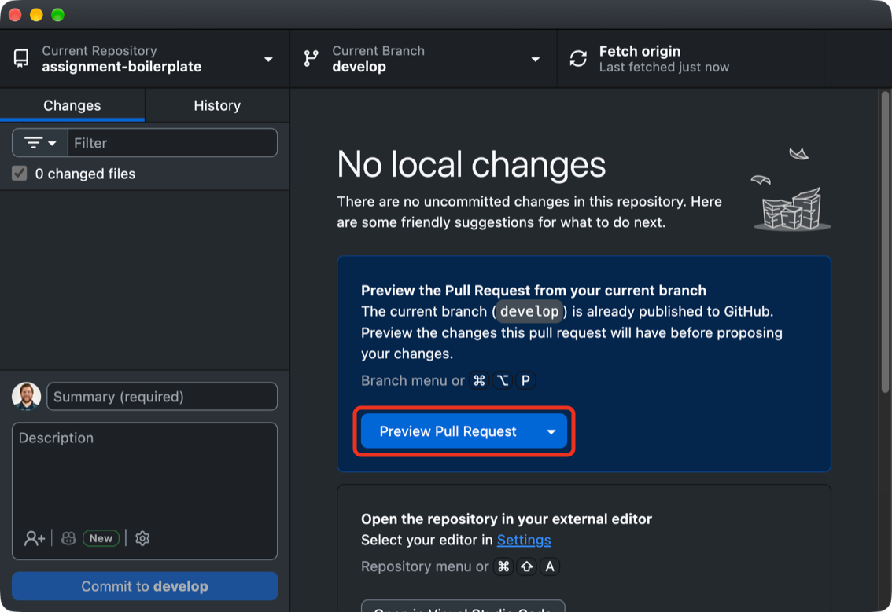
   - Confirm **base** is `main` and **compare** is `develop`, and title it with the
     assignment name.

     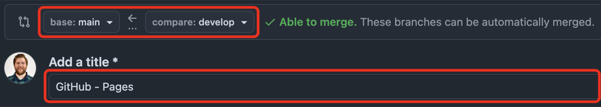
   - The description is pre-filled with a template. Fill in every section: paste your live
     GitHub Pages URL under **Live GitHub Pages URL**, write a short **Summary**, check off
     the **Checklist** by changing each `[ ]` to `[x]`, and answer the **Reflection**.
     **Notes for your instructor** is optional. Leave the `<!-- -->` hint lines as they are;
     they're hidden once the pull request is created.

     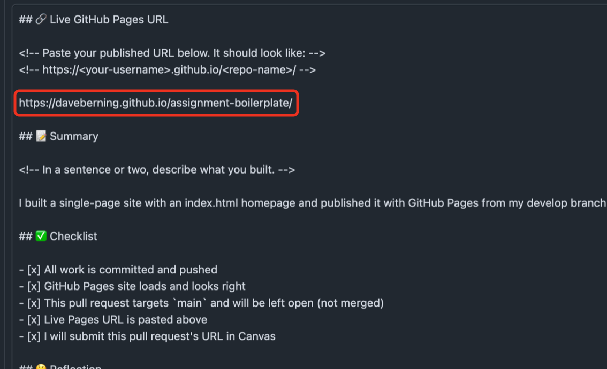
   - Click **Create pull request**.

     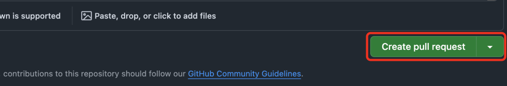
   - Your pull request opens. It should say **Open** and show it merging `develop` into
     `main`. Don't merge it.

     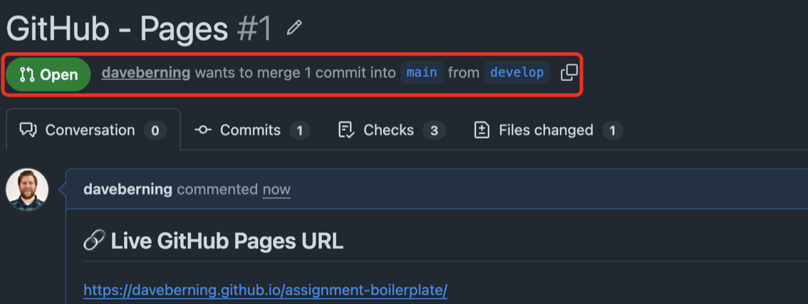
3. **Submit the pull request URL in Canvas.**
   - Copy the pull request URL from your browser's address bar. It looks like
     `https://github.com/<your-username>/<repo-name>/pull/1`.
   - Open the matching assignment in Canvas and click the red **Start Assignment** button.
     The page scrolls down to the submission form.

     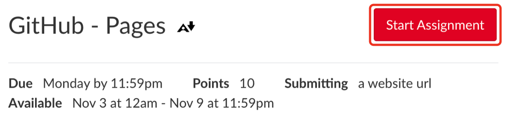
   - On the **Website URL** tab, paste your **pull request URL** into the **Website URL**
     field. Don't paste your GitHub Pages URL here; that goes in the pull request.
   - Optional: add a note for your instructor in **Comments**.
   - Click the red **Submit Assignment** button.

     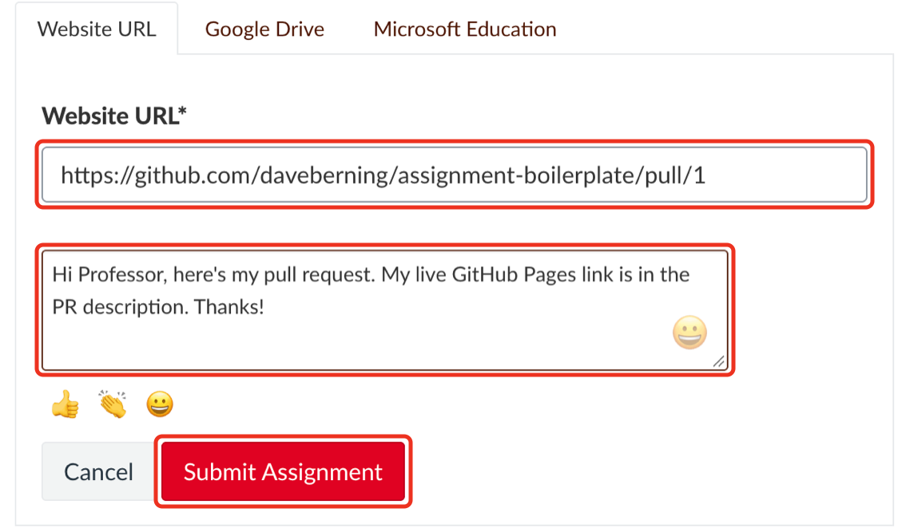

</details>

> [!CAUTION]
> Late or missing submissions are graded on what is in the pull request at the deadline, so push your final commits before you submit.
